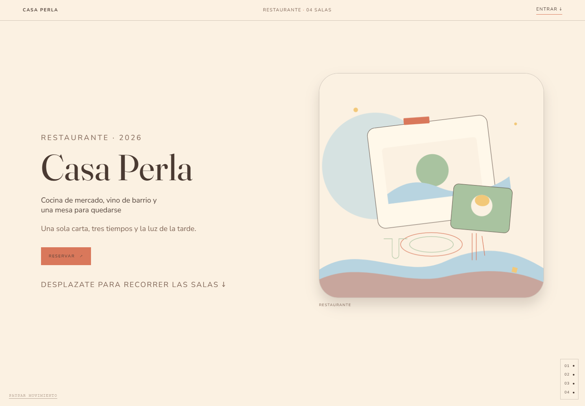
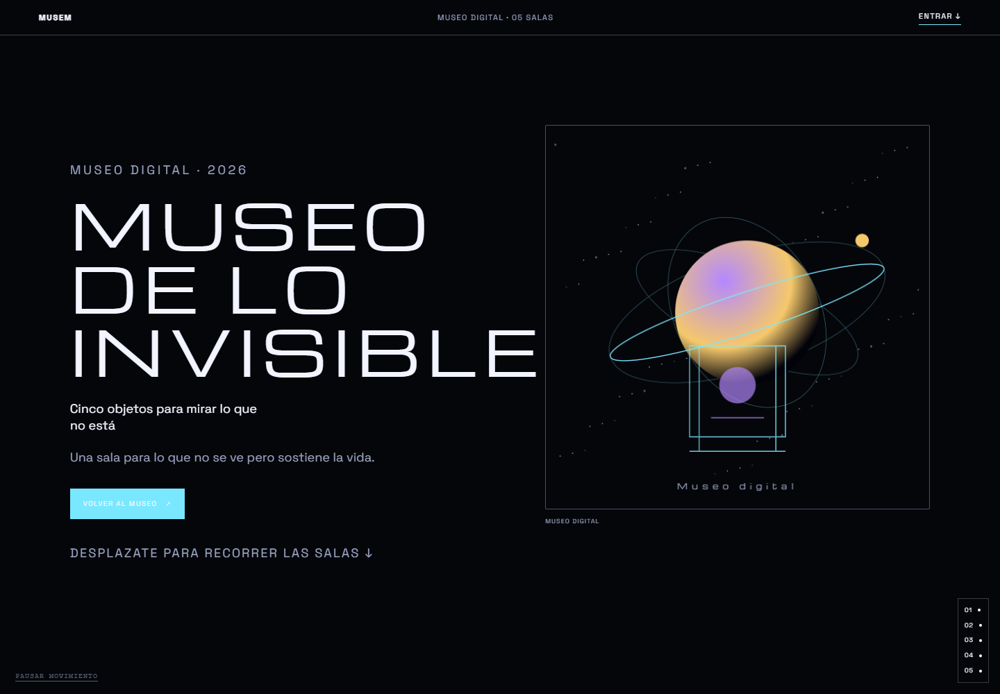
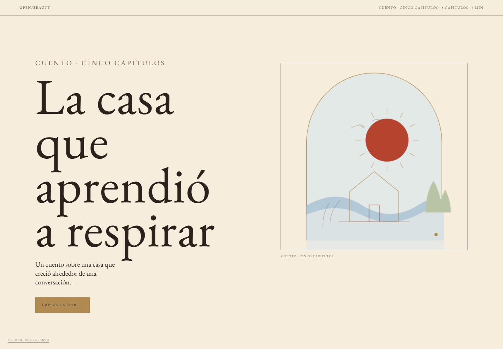
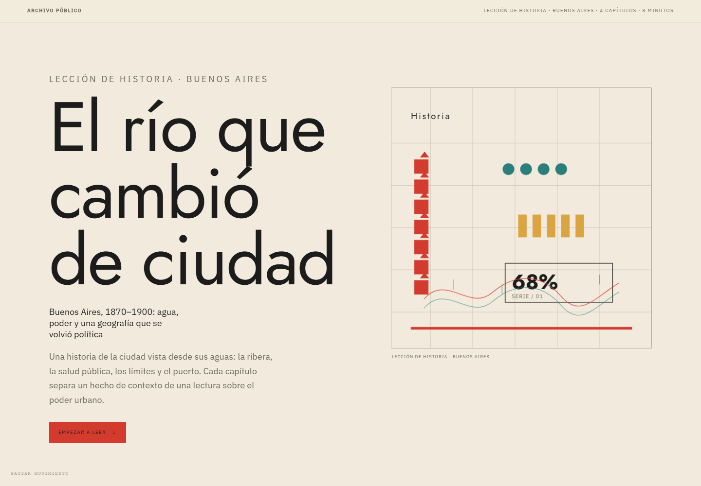
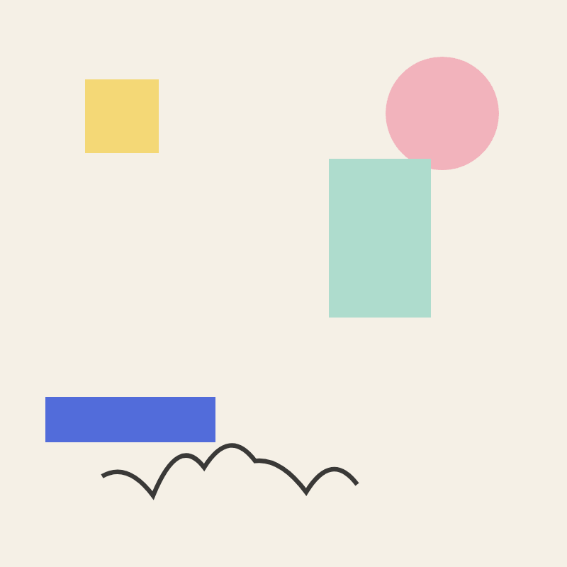
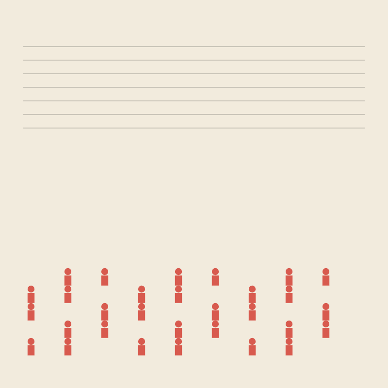

# Open Beauty

<p align="center">
  
  
  
  
</p>


## Una casa editorial para un internet vivo

Una página puede servir para algo y, aun así, pedir que nos quedemos. Puede enseñar, orientar, contar un cuento, abrir un museo o hacer una reunión más honesta. **Open Beauty** construye esa clase de web: piezas con una voz, una forma y una razón para existir.

### La tesis

El internet se vuelve vivo cuando cada página deja de ser una plantilla que reparte información y se convierte en un lugar que podemos recorrer. A veces es un fresco para pensar; otras, una sala de museo, una mesa de restaurante, un capítulo de historia o una retrospectiva de equipo. La forma debe ayudar a mirar, entender y recordar. La utilidad no cancela el arte; el arte puede volver más clara la utilidad.

Open Beauty es una casa editorial para producir esas piezas. El brief trae el tema, los hechos y la voz. El sistema aporta composición, tipografía, color, movimiento y una revisión de oficio. El resultado puede ser una página HTML, un lugar hecho de salas, un relato por capítulos, una presentación o un GIF. **La máquina pone las reglas visuales; quien escribe sigue siendo responsable de lo que afirma.**

## Doce maneras de mirar

No son doce pieles para una misma plantilla. Cada estilo propone una gramática para ordenar la atención. Abrí cualquier imagen para recorrer su ejemplo.

<p align="center">
  <a href="examples/renaissance/index.html"></a>
  <a href="examples/brutalist/index.html"></a>
  <a href="examples/papercraft/index.html"></a>
  <br>
  <sub><a href="examples/renaissance/index.html">Renaissance</a> · idea como fresco</sub> &nbsp; · &nbsp;
  <sub><a href="examples/brutalist/index.html">Brutalist</a> · postura como cartel</sub> &nbsp; · &nbsp;
  <sub><a href="examples/papercraft/index.html">Paper Craft</a> · trabajo hecho a mano</sub>
</p>

<p align="center">
  <a href="examples/showcase/artdeco/index.html"></a>
  <a href="examples/showcase/isotype/index.html"></a>
  <a href="examples/showcase/opart/index.html"></a>
  <br>
  <sub><a href="examples/showcase/artdeco/index.html">Art Deco</a> · geometría, altura y tiempo</sub> &nbsp; · &nbsp;
  <sub><a href="examples/showcase/isotype/index.html">Isotype</a> · datos como lenguaje común</sub> &nbsp; · &nbsp;
  <sub><a href="examples/showcase/opart/index.html">Op Art</a> · el ojo participa del argumento</sub>
</p>

<p align="center">
  <a href="examples/showcase/ukiyoe/index.html"></a>
  <a href="examples/showcase/bestiary/index.html"></a>
  <a href="examples/showcase/psychedelic/index.html"></a>
  <br>
  <sub><a href="examples/showcase/ukiyoe/index.html">Ukiyo-e</a> · paisaje como estampa</sub> &nbsp; · &nbsp;
  <sub><a href="examples/showcase/bestiary/index.html">Bestiario</a> · curiosidad como manuscrito</sub> &nbsp; · &nbsp;
  <sub><a href="examples/showcase/psychedelic/index.html">Psicodelia</a> · color para explorar</sub>
</p>

<p align="center">
  <a href="examples/showcase/memphis/index.html"></a>
  <a href="examples/showcase/vaporwave/index.html"></a>
  <a href="examples/showcase/galactic/index.html"></a>
  <br>
  <sub><a href="examples/showcase/memphis/index.html">Memphis</a> · humor con rigor</sub> &nbsp; · &nbsp;
  <sub><a href="examples/showcase/vaporwave/index.html">Vaporwave / Y2K</a> · una interfaz vieja que aún responde</sub> &nbsp; · &nbsp;
  <sub><a href="examples/showcase/galactic/index.html">Galactic Futurism</a> · memoria en una sala planetaria</sub>
</p>

La revisión de 2026 define para cada estilo su promesa, tipografía y movimiento. En todos, el movimiento debe ordenar la lectura; el estado de movimiento reducido deja el contenido disponible. [Leer la revisión editorial](docs/STYLE-REVIEW-2026.md) · [Recorrer la galería](examples/showcase/index.html) · [Ver las 12 páginas de la ronda](examples/agents/round-2026/index.html).

## Lugares que se recorren, historias que se leen

`beauty_create_experience` convierte un lugar en una secuencia de **3 a 8 salas**: cada una tiene una escena, un texto breve y, cuando hace falta, objetos. Sirve para restaurantes, museos, historia, estudios, clubes y jardines. No es una landing con secciones: la primera sala recibe y la última deja una puerta abierta.

`beauty_create_story` compone cuentos, ensayos narrativos y lecciones de historia en **2 a 8 capítulos**, con cubierta, navegación, texto, hechos al margen y fuente. En historia, las fechas, citas y atribuciones deben venir del brief o de una fuente; una herramienta de diseño no sustituye la investigación.

<p>
  <a href="examples/experiences/casa-perla.html"></a><br>
  <strong><a href="examples/experiences/casa-perla.html">Casa Perla</a></strong> · restaurante, mercado y mesa larga.
</p>

<p>
  <a href="examples/experiences/museo-invisible.html"></a><br>
  <strong><a href="examples/experiences/museo-invisible.html">Museo de lo invisible</a></strong> · cinco salas para mirar aquello que suele quedar fuera de la vitrina.
</p>

<p>
  <a href="examples/stories/casa-respira.html"></a><br>
  <strong><a href="examples/stories/casa-respira.html">La casa que aprendió a respirar</a></strong> · un cuento en cinco capítulos.
</p>

<p>
  <a href="examples/stories/rio-1870.html"></a><br>
  <strong><a href="examples/stories/rio-1870.html">El río que cambió de ciudad</a></strong> · una historia urbana narrada por capítulos.
</p>

## Para empresas

Una reunión puede dejar algo mejor que una lista de estados. El deck crea una sala para revisar el sprint con evidencia y decisiones; una retrospectiva para nombrar qué cuidar, detener y probar; o una planificación que explicita el resultado buscado, la capacidad real y lo que queda fuera. Números, aprendizajes y voces deben ser reales. La herramienta no rellena métricas.

En el challenge de rituales ágiles hay tres decks y tres GIFs. Cada GIF abre la puerta; el deck contiene la conversación.

<p align="center">
  <a href="examples/agile/sprint-14-review.html"></a>
  <a href="examples/agile/sprint-14-retro.html"></a>
  <a href="examples/agile/sprint-15-planning.html"></a>
  <br>
  <sub><a href="examples/agile/sprint-14-review.html">Sprint 14 · Review</a></sub> &nbsp; · &nbsp;
  <sub><a href="examples/agile/sprint-14-retro.html">Sprint 14 · Retrospective</a></sub> &nbsp; · &nbsp;
  <sub><a href="examples/agile/sprint-15-planning.html">Sprint 15 · Planning</a></sub>
</p>

## Para aulas

Una lección también puede ser un recorrido. Abrí con una pregunta; acercá un objeto, una fecha o una idea; dejá que cada sala o capítulo agregue contexto; cerrá con una fuente y algo para observar. Hay ejemplos de perspectivas y museo en [La città ideale](examples/education/renaissance-perspective.html) y [Museo de las Cosas Pequeñas](examples/education/papercraft-museum.html). Para una lección histórica, distinguí el dato de la interpretación, citá la fuente y marcá lo incierto. En proyector, el texto debe seguir legible y el movimiento nunca debe cargar con la explicación.

## Diez herramientas, una secuencia clara

El servidor MCP trabaja por **stdio**. No llama a un modelo, no navega la web ni verifica la verdad de los datos: transforma un brief en un artefacto y audita su forma. Estas son las diez herramientas:

**Orientar:**

- `beauty_list_styles` — lista los estilos y sus usos.
- `beauty_get_style` — entrega tokens, reglas y límites del estilo elegido.
- `beauty_get_skill` — carga las instrucciones de página, deck, experiencia, cuento o trabajo ágil.

**Crear:**

- `beauty_create_page` — página editorial.
- `beauty_create_experience` — lugar dividido en salas.
- `beauty_create_story` — relato o lección por capítulos.
- `beauty_create_deck` — presentación 16:9 navegable.
- `beauty_create_gif` — pieza breve animada; una tapa, no una agenda.

**Revisar y encontrar:**

- `beauty_validate` — revisa craft, visión y problemas concretos de un archivo.
- `beauty_examples` — señala las rutas de los ejemplos de referencia.

## El flujo de Luna

Luna trabaja dentro del cliente MCP; no escribe HTML a mano. Primero lista los estilos y escoge uno por el tema. Después lee `beauty_get_style` y la skill adecuada con `beauty_get_skill`. Convierte el encargo en un brief con voz y hechos concretos; llama a la herramienta de creación que corresponde; y pasa el resultado por `beauty_validate`. Si el validador encuentra un problema, corrige el brief o la composición y vuelve a revisar. La meta técnica de la casa es **A/100 y visión 4/4**; la última lectura humana todavía pregunta si la pieza enseña, conmueve o ayuda a actuar.

La [ronda 2026 de Luna](docs/STYLE-REVIEW-2026.md) conserva los resultados por estilo. El deck [La memoria del futuro](examples/luna-deck/memory-future.html) muestra el flujo de presentación.

### Lo que ya se puso a prueba

- La suite registrada en [Testing](docs/TESTING.md) reporta **15/15 pruebas aprobadas**.
- En la ronda de estilos de Luna: **12/12 páginas A/100 y visión 4/4**.
- El deck de Luna tiene **8 slides** —cubierta, seis slides de contenido y cierre— y obtuvo A/100, visión 4/4.
- La nueva colección ofrece **cuatro experiencias y relatos**: dos lugares y dos historias.
- El challenge de empresa reúne **tres decks y tres GIFs**: review, retrospectiva y planning.

### Límites que importan

- Los decks todavía no tienen un layout `figure` con imagen, pie y fuente.
- Los perfiles de movimiento están definidos por estilo, no por cada subfamilia.
- El servidor no busca fuentes ni trae datos: quien prepara el brief responde por cifras, fechas, citas y atribuciones. El validador comprueba reglas de diseño y estructura; no hace verificación factual ni reemplaza la inspección en un navegador.

La mesa de ideas de artistas, escritores, lectores, diseñadores y curadores está en [`docs/IDEAS-2026.md`](docs/IDEAS-2026.md): lo que vieron, lo que implementamos y lo que sigue.

## Cómo se construye

- **Un archivo por pieza.** El HTML es autocontenido: CSS y JavaScript inline, arte SVG, sin runtime de framework. Se abre en cualquier navegador y se imprime.
- **El gusto es dato.** `src/styles/presets.ts` guarda paleta, fuentes, reglas, `typeSystem`, `motionSystem` y subfamilias; `src/art.ts` dibuja escenas originales por estilo y asunto (mesa, vitrina, río, casa).
- **La IA no toca el CSS.** El modelo elige un estilo, escribe el brief y llama a una herramienta; el renderer decide composición, escalas, bordes y movimiento.
- **El validador no es un navegador.** Audita tokens, contraste, estructura, accesibilidad y ritmo; la última lectura sigue siendo humana.

## Empezar

Requisitos: **Node.js 22 o superior** y **pnpm**. Desde una terminal:

```bash
git clone https://github.com/jdsalasca/open-beauty-site.git
cd open-beauty-site
pnpm setup
pnpm mcp:config
```

`pnpm mcp:config` imprime el bloque para registrar el servidor en un cliente compatible con MCP local por stdio. Pegalo en la configuración de Codex, Claude Code u otro cliente y pedile a Luna que empiece por `beauty_list_styles`. La configuración detallada está en [docs/MCP.md](docs/MCP.md). La galería de ejemplos está en [examples/index.html](examples/index.html).

La app web estándar de ChatGPT no puede lanzar un proceso MCP local: necesitás un cliente con MCP stdio (Codex CLI, Claude Desktop/Code o Cursor) o un puente HTTP. El servidor no llama a un modelo, no navega la web y no verifica la verdad de los datos.

---

**Open Beauty**: la web puede volver a ser un lugar para mirar, aprender, encontrarse y seguir una historia. Una buena página abre la puerta. Lo que pasa adentro depende de la verdad y el cuidado de quien la escribe.

## Licencia

MIT. Las fuentes incluidas son OFL y están documentadas en [`fonts/`](fonts/). El repositorio es una herramienta editorial, no una fuente de verdad: las citas, fechas y métricas son responsabilidad del brief y de la fuente.
