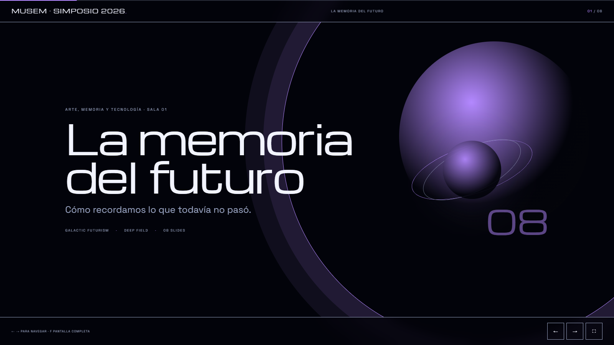

<p align="center">
  <strong>open-beauty-site</strong><br>
  <em>A design harness for models that can't design.</em>
</p>

<p align="center">
  
  
  
  
</p>

---

**ES** — Un harness de diseño en TypeScript con servidor MCP. Le das a un modelo un brief corto y devuelve una página HTML completa o un GIF, con tipografía, paleta, bordes, movimiento y validación ya decididos. La IA escribe el contenido; el sistema escribe el gusto.

**EN** — A TypeScript design harness with an MCP server. Give a small model a short brief and get a complete HTML page or looping GIF with typography, palette, borders, motion and a validator already decided. The model writes content; the system writes taste.


## La web que queremos

Queremos una web que trate cada página como una pieza editorial con una idea propia. La forma nace del tema: un fresco para leer una relación entre imagen y poder; una retícula para entender una cifra; una estampa para situar un paisaje; una órbita para escuchar una memoria. Los estilos no son disfraces que se aplican al final: son gramáticas para ordenar atención, materia, ritmo y evidencia.

En tres segundos, la persona recuerda el asunto además de la forma. Por eso cada página necesita una escala que se lea de lejos, un detalle concreto que resista la mirada y una voz que no podría pertenecer a cualquier proyecto. Preferimos una fecha, un objeto, una medida o una pregunta precisa a las promesas intercambiables. La composición deja aire para pensar, concentra el acento y rompe la pauta cuando esa ruptura revela algo.

Queremos una casa para doce lenguajes visuales, no doce variaciones de una plantilla. Un manuscrito puede anotar al margen; un cartel puede hablar en imperativos; el papel cortado puede contar quién lo hizo. La técnica sostiene la libertad: texto legible, contraste suficiente, movimiento controlable y datos honestos. Al final, la prueba es simple: después de cerrar la página, ¿qué idea queda, qué detalle la vuelve cierta y qué gesto invita a continuar?

*Texto de la mesa editorial 2026, con dirección de Luna 6 Max.*

## Por qué existe

Los modelos chicos pueden escribir un buen titular. Lo que no pueden hacer de forma consistente es elegir una tipografía, un acento, un ancho de borde y un ritmo de animación que funcionen juntos. El resultado típico es la estética "IA genérica": Inter, tarjetas redondeadas, degradados violetas, todo centrado, nada recordado.

Este repo mueve esas decisiones a **doce sistemas editoriales** completos. El modelo solo tiene que elegir uno, escribir contenido real y llamar a una herramienta.

- **Sin LLM en runtime.** El render es determinista: brief + preset → HTML/GIF.
- **Sin plantillas genéricas.** Cada estilo tiene su propio layout, no un recoloreo.
- **Con validador.** Una página que se sale de la línea editorial se detecta y se corrige antes de publicar.
- **Un solo archivo.** El HTML es autocontenido; el GIF se genera con canvas y `gifenc`.

## MUSEM

El museo real que salió de este harness: [**musem.eridu.top**](https://musem.eridu.top). Seis salas, entrada libre, sin stock. La primera es **Random Access Memories** (Daft Punk, 2013) en Galactic Futurism, con una suite original de 160 s creada por [`open-music`](https://github.com/jdsalasca/open-music). La galería se publica como un sitio estático en el servidor de Eridu; el runbook vive en `server/musem/README.md`, dentro del repo de infraestructura local.

## Los doce estilos

Los tres clásicos:

| Renaissance | Brutalist | Paper Craft |
| --- | --- | --- |
|  |  |  |
| Pergamino, tinta, oro. Simetría, arco, capitular. Lento y digno. | Papel, tinta, ácido. 3px, sombras duras, marquee. Ruidoso. | Crema, kraft, washi tape. Capas, recortes, flotación. Cálido. |
| `EB Garamond` | `Archivo Black` + `Space Mono` | `Fraunces` + `Nunito Sans` |

Cada estilo incluye tokens exactos, reglas de layout, recetas de componentes, voz de copy y una lista de "nunca". Están en [`docs/STYLEGUIDE.md`](docs/STYLEGUIDE.md) y en las skills de [`skills/`](skills/).

La ronda 2026 de dirección editorial, tipografía y movimiento está en [`docs/STYLE-REVIEW-2026.md`](docs/STYLE-REVIEW-2026.md): promesa, tres segundos, error común, tipografía y motion de los doce.

## Nueve direcciones nuevas

Nueve sistemas completos, con arte SVG/CSS original, interacción y GIF. Todos validan **A/100 + vision 4/4**. Recorrelos en [`examples/showcase/`](examples/showcase/index.html) o mirá la comparación **lado a lado** con Luna 6 Max en [`examples/compare.html`](examples/compare.html).

[](examples/compare.html)

| Art Deco | Isotype | Op Art | Ukiyo-e |
| --- | --- | --- | --- |
|  |  |  |  |
| [La ciudad vertical](examples/showcase/artdeco/index.html) · `Poiret One` | [Viena 1925](examples/showcase/isotype/index.html) · `Jost` | [Tu ojo miente](examples/showcase/opart/index.html) · `Archivo Black` | [La ola que se repite](examples/showcase/ukiyoe/index.html) · `Shippori Mincho B1` |

| Bestiario | Psicodelia | Memphis | Vaporwave / Y2K |
| --- | --- | --- | --- |
|  |  |  |  |
| [Animales que nunca existieron](examples/showcase/bestiary/index.html) · `UnifrakturMaguntia` | [Carteles que vibran](examples/showcase/psychedelic/index.html) · `Bungee Shade` | [El mal gusto es un método](examples/showcase/memphis/index.html) · `Bricolage Grotesque` | [La historia de internet en 12 ventanas](examples/showcase/vaporwave/index.html) · `Press Start 2P` |

**Galactic Futurism**, la novena: un planetario de memoria para la Sala 01 de MUSEM. `Michroma` + `Space Grotesk`, un planeta anillado, órbitas lentas y una suite original de 160 s generada con [`open-music`](https://github.com/jdsalasca/open-music).

[](examples/showcase/galactic/index.html)

**Interacción real:** el sol de Art Deco gira, Isotype cuenta pictogramas con tabs 1925/1934, Op Art sigue el puntero y congela el moiré, Ukiyo-e mueve las olas, el bestiario parpadea, la psicodelia respira, Memphis revuelve sus formas, la ventana de Vaporwave se puede arrastrar y el planeta Galactic respira sobre tres órbitas. Todas las páginas suman una barra de progreso y un control de pausa para el movimiento.

### GIFs

| Renaissance | Brutalist | Paper Craft |
| --- | --- | --- |
|  |  |  |

Los doce salen del mismo comando que las páginas y comparten la línea editorial.

## Ronda de estilos 2026

Doce estilos, doce revisiones. La mesa editorial de **Luna 6 Max** trabajó en tres frentes —dirección editorial, tipografía y movimiento— y el harness convirtió las decisiones en tokens, no en prosa suelta.

- **Tipografía:** cada preset tiene `typeSystem` (caja, tracking, leading, tamaño de cuerpo, features OpenType). No se agregaron familias; se ajustó cómo se usan.
- **Caligrafía:** los titulares dejaron de ser una escala única; el cuerpo vive entre 18 y 20 px en los doce estilos y los rótulos principales tienen un piso de 11 px. La regla es legibilidad a 360 px y en proyector.
- **Motion:** cada preset tiene `motionSystem` (entrada, distancia, stagger, easing, ambiente, hover, transición y estado reducido). La página incorpora una barra de progreso, un fade de entrada y un reveal con el ritmo del estilo.
- **Voz:** las nueve direcciones showcase dejaron de compartir la misma pauta de copy. Art Deco habla como programa de cine; Isotype como pie de dato público; Ukiyo-e como estampa de viaje; Galactic como nota de planetario.
- **Subfamilias:** las 36 familias eligen `sala`, `gabinete` o `cartel` según la estructura, no solo según el acento.
- **Accesibilidad:** `prefers-reduced-motion` muestra el estado final, sin bucles ni desplazamiento suave; cada página tiene un control discreto para **pausar/reanudar** el movimiento.

El detalle completo —promesa, tres segundos, error común, tipografía y motion de los doce— está en [`docs/STYLE-REVIEW-2026.md`](docs/STYLE-REVIEW-2026.md).

## Movimiento y educación

La animación no es un adorno: es una forma de ordenar la atención. En un aula o en un proyector, el movimiento tiene que ayudar a leer, no reemplazar la lectura.

1. **La animación ordena la mirada, no la información.** Título, explicación y cifras se entienden sin esperar una secuencia.
2. **Un foco móvil por escena.** Párrafos quietos; nada de texto letra por letra ni desplazamientos de toda la pantalla.
3. **Movimiento suave, lento y con intención.** Sin destellos, rebotes, zooms ni muaré autónomo; si el ambiente dura, debe poder pausarse.
4. **La interacción no depende de hover.** Teclado, toque y foco visible tienen que funcionar igual.
5. **`prefers-reduced-motion` es una ciudadana de primera.** Estado final inmediato, bucles detenidos y contenido completo.

## Sitios educativos

El harness también sirve para lecciones, museos y explicadores, no solo para landings. Dos versiones propias, con copy real y fuentes citadas:

| Renaissance | Paper Craft |
| --- | --- |
|  |  |
| [La città ideale](examples/education/renaissance-perspective.html) — perspectiva, espacio y poder. Campos planos de fresco, EB Garamond, plato asimétrico. | [Museo de las Cosas Pequeñas](examples/education/papercraft-museum.html) — insectos y semillas. Fraunces, capas de papel, geometría cortada. |

Ambas pasan A/100 y vision 4/4. El método para escribir una lección está en [`skills/education.md`](skills/education.md).

## Presentaciones

El harness ahora genera **decks 16:9 animados**, no solo páginas. `beauty_create_deck` arma portada, contenido, cierre, navegación con teclado/swipe, progreso, fullscreen, print y `aria-live`. La validación de deck mide palabras por slide, puntos, monotonía de layouts, `inert`, `aria-live` y print.

Cada estilo tiene **3 subfamilias** (36 en total). No son solo colores: `composition` cambia la estructura entre `sala`, `gabinete` y `cartel`; el acento sale siempre de la paleta del estilo.

**Deck de Luna 6 Max** — 8 slides, A/100 + vision 4/4, 47.481 tokens, sin HTML escrito a mano:

[](examples/luna-deck/memory-future.html)

[Ver la presentación](examples/luna-deck/memory-future.html) · [Leer la skill de presentación](skills/presentation.md)

## Quickstart

Requisitos: Node ≥ 22, pnpm, Git.

```bash
git clone https://github.com/jdsalasca/open-beauty-site.git
cd open-beauty-site
pnpm setup            # install + build + 13 tests
pnpm mcp:config       # imprime el bloque exacto para Codex/Claude/Cursor

# ver los estilos
node dist/cli.js styles

# crear una página
node dist/cli.js page \
  --style brutalist \
  --title "LUNA / SIGNAL" \
  --tagline "A transmission from the other side of the prompt." \
  --intro "We build signals for people who are tired of being talked to." \
  --out out/luna.html

# crear una presentación 16:9 (brief con slides)
node dist/cli.js deck \
  --style galactic \
  --brief deck.json \
  --subfamily deep-field \
  --out out/deck.html

# crear un GIF (tapa corta, no una lista)
node dist/cli.js gif \
  --style papercraft \
  --text "Taller Papel" \
  --subtitle "Hecho a mano" \
  --out out/taller.gif

# un GIF no enumera objetivos: es una tapa.
# para "objetivos del sprint", usá "Sprint 14" en el GIF y una página/deck con los 3 objetivos.

# auditar
node dist/cli.js validate out/luna.html --style brutalist --strict
```

También podés generar todos los ejemplos:

```bash
pnpm examples          # 3 clásicos + 3 GIFs
pnpm education         # 2 lecciones
pnpm showcase          # 9 estilos nuevos + 9 GIFs + galería
pnpm compare           # página de comparación con Luna
```

## MCP

El servidor habla stdio y expone ocho herramientas. Está pensado para que un modelo débil no tenga que adivinar nada.

**Otro PC, en tres pasos:** `git clone … && pnpm setup`, después `pnpm mcp:config` y pegá el bloque en tu cliente. ChatGPT web no puede lanzar un MCP local; usá un cliente con MCP stdio (Codex CLI, Claude Desktop/Code, Cursor) con Luna dentro.

```bash
node dist/mcp/server.js
```

### Claude Code

```bash
claude mcp add -s user open-beauty -- node "C:/absolute/path/open-beauty-site/dist/mcp/server.js"
```

### Codex

```toml
[mcp_servers.open_beauty]
command = "node"
args = ["C:/absolute/path/open-beauty-site/dist/mcp/server.js"]
startup_timeout_sec = 30.0
```

### Cursor / genérico

```json
{
  "mcpServers": {
    "open-beauty": {
      "command": "node",
      "args": ["C:/absolute/path/open-beauty-site/dist/mcp/server.js"]
    }
  }
}
```

### Herramientas

| Tool | Qué hace |
| --- | --- |
| `beauty_list_styles` | Lista los doce estilos y para qué sirve cada uno. |
| `beauty_get_style` | Devuelve tokens exactos, reglas y do/don't. Es la fuente de verdad. |
| `beauty_get_skill` | Devuelve la skill lista para pegar en el contexto del agente. |
| `beauty_create_page` | Crea una página completa y la escribe a disco. |
| `beauty_create_deck` | Crea una presentación 16:9 animada con subfamilia y validación de deck. |
| `beauty_create_gif` | Crea un GIF con el mismo estilo. |
| `beauty_validate` | Audita un HTML y devuelve score, grade y fixes. |
| `beauty_examples` | Devuelve las rutas de los ejemplos de referencia. |

Recursos: `beauty://styles/{slug}` para los doce estilos, `beauty://skills/beauty.md`, `beauty://skills/education.md` y `beauty://skills/presentation.md`.

El servidor manda instrucciones al conectarse: listar estilos → leer el estilo → crear con copy real → validar hasta A. La misma secuencia está en [`skills/beauty.md`](skills/beauty.md).

## Validación

El validador no es un navegador; es un auditor de la línea editorial. Devuelve dos números: **craft** (¿obedece el manual?) y **vision** (¿tiene una idea visual?).

```text
A · 100/100 · brutalist
vision 4/4 · all checks pass · scale-jump, flat-fields, asymmetry-or-bleed, material
No craft issues. The page respects the editorial system.
stats: {"bytes":18381,"colors":7,"fonts":["Space Mono","Archivo Black"],"radii":[],"durations":[0.25,0.3,0.45]}
```

Y cuando algo está mal:

```text
[error] forbidden-font: "Inter" is forbidden in Brutalist.
  fix: Use Archivo Black for display and Space Mono for text.
[warn] radius-out-of-range: border-radius 8px is outside Brutalist's 10–48px range.
  fix: Use a cut corner, not a generic rounded rectangle.
[error] hard-shadow-in-papercraft: Paper Craft shadows must be soft.
```

Chequea fuentes, colores, bordes, radios, sombras, motion, landmarks, placeholders y contraste. La **vision** mide salto de escala, campos planos de color, asimetría/sangría y materia física. Craft A + vision 4/4 es el estándar; el resto son páginas obedientes, no arte. Los criterios están en [`docs/ART-DIRECTION.md`](docs/ART-DIRECTION.md).

## Probado con modelos reales

No es una demo teórica. Varios agentes, estilos distintos, sin HTML escrito a mano:

| Agente | Estilo | Resultado | Evidencia |
| --- | --- | --- | --- |
| Codex CLI 0.163 · `gpt-6-luna` · effort `max` | Brutalist | **A · 100/100** | [`examples/agents/luna-brutalist.html`](examples/agents/luna-brutalist.html) |
| Codex CLI 0.163 · `gpt-6-luna` · effort `max` · v2 | Paper Craft | **A · 100/100 · vision 4/4** | [`examples/agents/luna-papercraft-v2.html`](examples/agents/luna-papercraft-v2.html) |
| Codex CLI 0.163 · `gpt-6-luna` · effort `max` · 8 nuevos | 8 estilos | **8/8 A · 100/100 · vision 4/4** | [`examples/compare.html`](examples/compare.html) |
| Codex CLI · `gpt-6-luna` · effort `max` · ronda 2026 | 12 estilos | **12/12 A · 100/100 · vision 4/4** | [12 páginas](examples/agents/round-2026/) · [review](docs/STYLE-REVIEW-2026.md) |
| `colmena-mcp` · worker `luna-max` · v1 | Paper Craft | **A · 100/100** | [`examples/agents/luna-papercraft.html`](examples/agents/luna-papercraft.html) |
| `colmena-mcp` · worker `max-hive` · LongCat 2.5 free | Renaissance | **A · 100/100** | [`examples/agents/hive-renaissance.html`](examples/agents/hive-renaissance.html) |

Luna llamó las herramientas MCP en orden y no escribió HTML. En la última ronda hicimos **doce corridas separadas**, una por estilo, con briefs distintos y validación real: **12/12 A/100 + vision 4/4**, 481.228 tokens en total. La página más cara fue Isotype (49.795) y la más barata Bestiary (21.296); el rango importa más que el promedio. En la corrida de presentación creó un deck de 8 slides en `galactic/deep-field`: **A/100 + vision 4/4**, 47.481 tokens. La comparación lado a lado con mis briefs está en [`examples/compare.html`](examples/compare.html). El detalle de los runs está en [`docs/TESTING.md`](docs/TESTING.md).

## Cómo funciona

```
brief + style ──► preset ──► renderer ──► HTML ──► validator ──► score + fixes
                     │
                     └────► canvas frames ──► gifenc ──► GIF
```

- `src/styles/presets.ts` — los doce sistemas como datos: paleta, fuentes, reglas, `typeSystem`, `motionSystem` y guía.
- `src/styles/design-language.ts` — los tokens de tipografía y movimiento que consume el shell común.
- `src/page/*.ts` — un renderer por estilo, con CSS y markup propios.
- `src/validate.ts` — auditoría y scoring.
- `src/gif.ts` — frames con `@napi-rs/canvas`, encoding con `gifenc`.
- `src/mcp/server.ts` — el servidor MCP.
- `src/cli.ts` — la misma funcionalidad desde la terminal.
- `skills/` — la mitad en lenguaje natural del harness.

Más detalle en [`docs/ARCHITECTURE.md`](docs/ARCHITECTURE.md), [`docs/MCP.md`](docs/MCP.md) y la [revisión editorial](docs/EDITORIAL-REVIEW.md).

## Estructura

```text
open-beauty-site/
├── src/            # presets, renderers, validator (craft + vision), GIF, MCP, CLI
├── skills/         # beauty.md + education.md + una skill por estilo
├── docs/           # style guide, art direction, MCP, arquitectura, testing
├── examples/       # 12 páginas, 12 GIFs, 2 lecciones, 8 de Luna, previews y compare.html
├── fonts/          # TTFs OFL para los GIFs
├── scripts/        # build de ejemplos/lecciones/showcase/docs, QA y e2e con colmena
└── test/           # tests de core y MCP
```

## Roadmap

- [x] **Art Deco**, **Isotype**, **Op Art**, **Ukiyo-e**, **Bestiario**, **Psicodelia**, **Memphis** y **Vaporwave**.
- [ ] Segunda composición por estilo (hoy `seed` varía en los 3 clásicos; los 8 nuevos usan una composición).
- [x] Formato presentación 16:9, animaciones, navegación y subfamilias.
- [ ] Bloques `figure`, `keyIdea`, `process` y export PDF con una página por slide.
- [ ] `beauty_create_social` para carruseles y OG images.
- [ ] Self-hosting de fuentes en el HTML para uso offline.
- [ ] Publicación en npm (`npx open-beauty-site`).

Las ideas completas, con paletas y tipografías, están en [`docs/ART-DIRECTION.md`](docs/ART-DIRECTION.md).

## Contribuir

Las contribuciones son bienvenidas. Si agregás un estilo, tiene que pasar el validador en A, tener su skill generada y un ejemplo visual. Leé [`CONTRIBUTING.md`](CONTRIBUTING.md).

## Licencia

MIT. Las fuentes incluidas son OFL: EB Garamond, Archivo Black, Space Mono, Fraunces y Nunito Sans. Las licencias están en [`fonts/`](fonts/).

Hecho con demasiado café en Buenos Aires.
