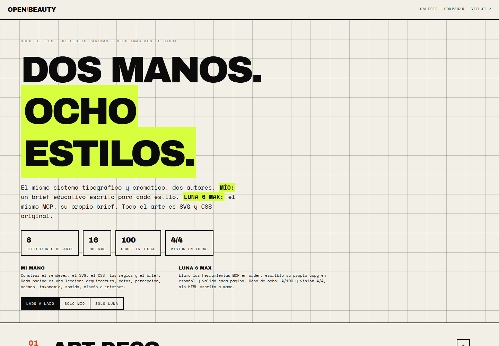
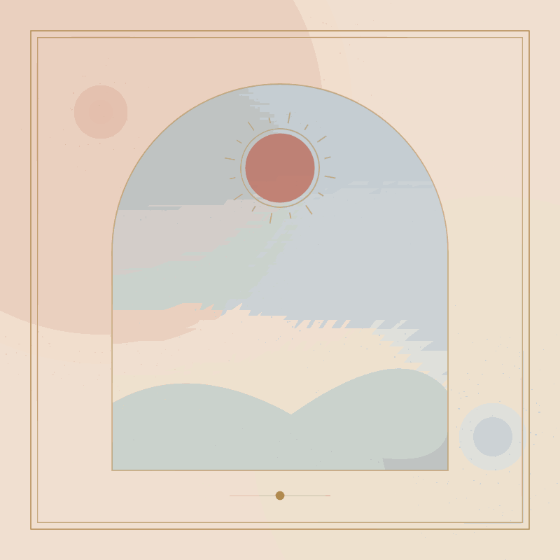
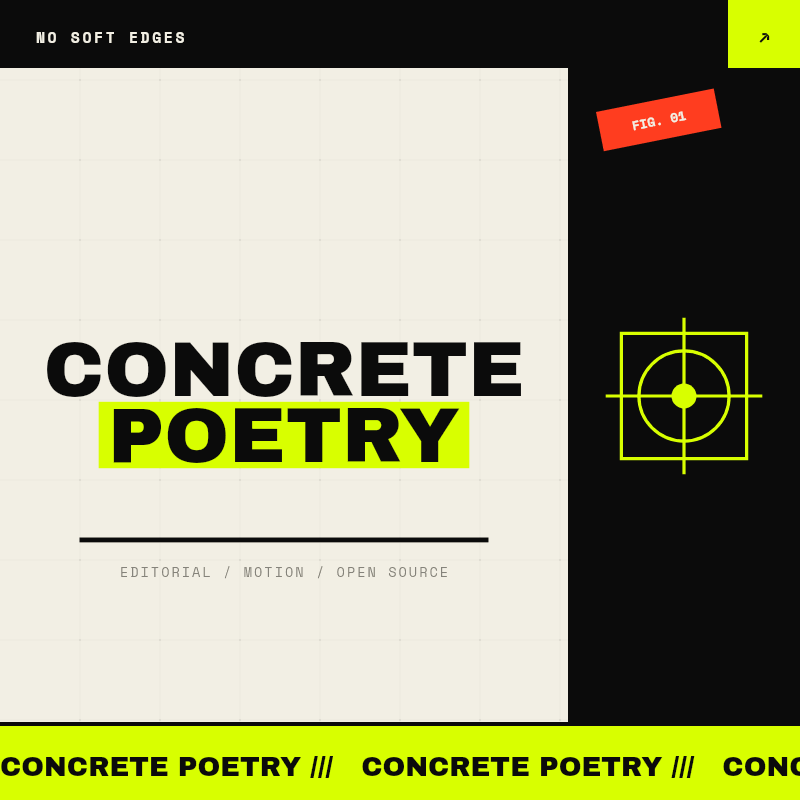
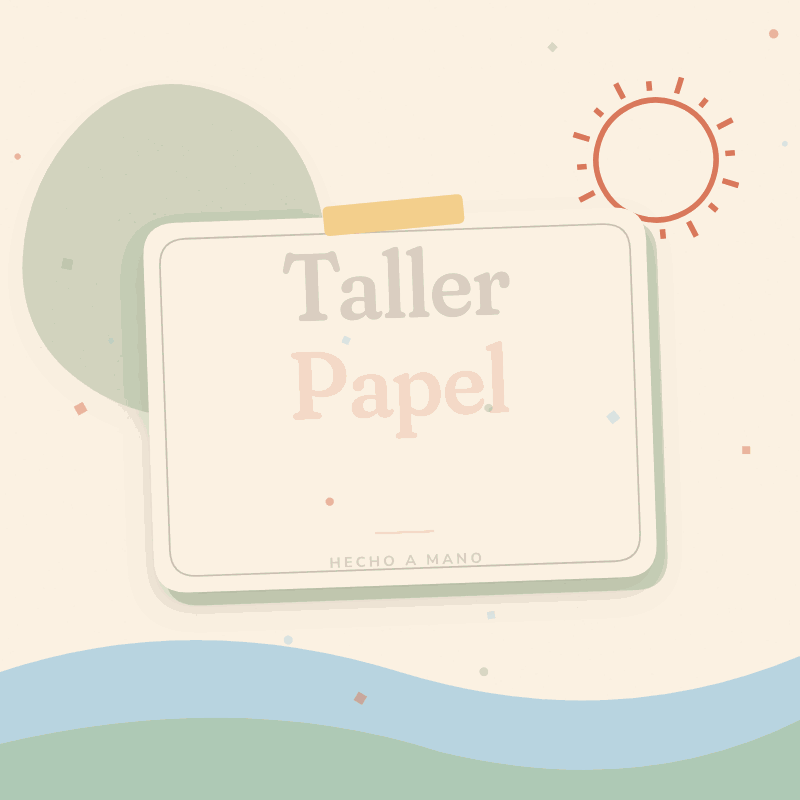
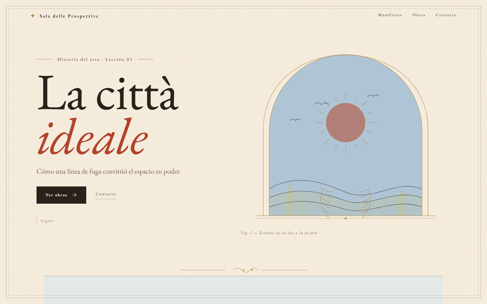
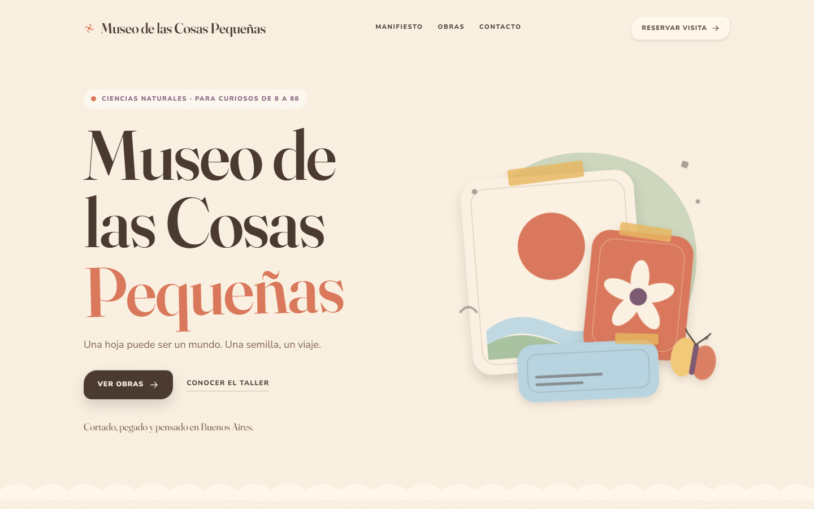

<p align="center">
  <strong>open-beauty-site</strong><br>
  <em>A design harness for models that can't design.</em>
</p>

<p align="center">
  
  
  
  
</p>

---

**ES** — Un harness de diseño en TypeScript con servidor MCP. Le das a un modelo un brief corto y devuelve una página HTML completa o un GIF, con tipografía, paleta, bordes, movimiento y validación ya decididos. La IA escribe el contenido; el sistema escribe el gusto.

**EN** — A TypeScript design harness with an MCP server. Give a small model a short brief and get a complete HTML page or looping GIF with typography, palette, borders, motion and a validator already decided. The model writes content; the system writes taste.


## Por qué existe

Los modelos chicos pueden escribir un buen titular. Lo que no pueden hacer de forma consistente es elegir una tipografía, un acento, un ancho de borde y un ritmo de animación que funcionen juntos. El resultado típico es la estética "IA genérica": Inter, tarjetas redondeadas, degradados violetas, todo centrado, nada recordado.

Este repo mueve esas decisiones a **once sistemas editoriales** completos. El modelo solo tiene que elegir uno, escribir contenido real y llamar a una herramienta.

- **Sin LLM en runtime.** El render es determinista: brief + preset → HTML/GIF.
- **Sin plantillas genéricas.** Cada estilo tiene su propio layout, no un recoloreo.
- **Con validador.** Un página que se sale de la línea editorial se detecta y se corrige antes de publicar.
- **Un solo archivo.** El HTML es autocontenido; el GIF se genera con canvas y `gifenc`.

## Los once estilos

Los tres clásicos:

| Renaissance | Brutalist | Paper Craft |
| --- | --- | --- |
|  |  |  |
| Pergamino, tinta, oro. Simetría, arco, capitular. Lento y digno. | Papel, tinta, ácido. 3px, sombras duras, marquee. Ruidoso. | Crema, kraft, washi tape. Capas, recortes, flotación. Cálido. |
| `EB Garamond` | `Archivo Black` + `Space Mono` | `Fraunces Soft` + `Nunito Sans` |

Cada estilo incluye tokens exactos, reglas de layout, recetas de componentes, voz de copy y una lista de "nunca". Están en [`docs/STYLEGUIDE.md`](docs/STYLEGUIDE.md) y en las skills de [`skills/`](skills/).

## Ocho direcciones nuevas

Ocho sistemas completos, con arte SVG/CSS original, interacción y GIF. Todos validan **A/100 + vision 4/4**. Recorrelos en [`examples/showcase/`](examples/showcase/index.html) o mirá la comparación **lado a lado** con Luna 6 Max en [`examples/compare.html`](examples/compare.html).`n`n[](examples/compare.html)

| Art Deco | Isotype | Op Art | Ukiyo-e |
| --- | --- | --- | --- |
|  |  |  |  |
| [La ciudad vertical](examples/showcase/artdeco/index.html) · `Poiret One` | [Viena 1925](examples/showcase/isotype/index.html) · `Jost` | [Tu ojo miente](examples/showcase/opart/index.html) · `Archivo Black` | [La ola que se repite](examples/showcase/ukiyoe/index.html) · `Shippori Mincho B1` |

| Bestiario | Psicodelia | Memphis | Vaporwave / Y2K |
| --- | --- | --- | --- |
|  |  |  |  |
| [Animales que nunca existieron](examples/showcase/bestiary/index.html) · `UnifrakturMaguntia` | [Carteles que vibran](examples/showcase/psychedelic/index.html) · `Bungee Shade` | [El mal gusto es un método](examples/showcase/memphis/index.html) · `Bricolage Grotesque` | [La historia de internet en 12 ventanas](examples/showcase/vaporwave/index.html) · `Press Start 2P` |

**Interacción real:** el sol de Art Deco gira, Isotype cuenta pictogramas con tabs 1925/1934, Op Art sigue el puntero y congela el moiré, Ukiyo-e mueve las olas, el bestiario parpadea, la psicodelia respira, Memphis revuelve sus formas y la ventana de Vaporwave se puede arrastrar.

### GIFs

| Renaissance | Brutalist | Paper Craft |
| --- | --- | --- |
|  |  |  |

Los once salen del mismo comando que las páginas y comparten la línea editorial.

## Sitios educativos

El harness también sirve para lecciones, museos y explicadores, no solo para landings. Dos versiones propias, con copy real y fuentes citadas:

| Renaissance | Paper Craft |
| --- | --- |
|  |  |
| [La città ideale](examples/education/renaissance-perspective.html) — perspectiva, espacio y poder. Campos planos de fresco, EB Garamond, plato asimétrico. | [Museo de las Cosas Pequeñas](examples/education/papercraft-museum.html) — insectos y semillas. Fraunces Soft, capas de papel, geometría cortada. |

Ambas pasan A/100 y vision 4/4. El método para escribir una lección está en [`skills/education.md`](skills/education.md).

## Quickstart

Requisitos: Node ≥ 22, pnpm, Git.

```bash
git clone https://github.com/jdsalasca/open-beauty-site.git
cd open-beauty-site
pnpm install
pnpm build

# ver los estilos
node dist/cli.js styles

# crear una página
node dist/cli.js page \
  --style brutalist \
  --title "LUNA / SIGNAL" \
  --tagline "A transmission from the other side of the prompt." \
  --intro "We build signals for people who are tired of being talked to." \
  --out out/luna.html

# crear un GIF
node dist/cli.js gif \
  --style papercraft \
  --text "Taller Papel" \
  --subtitle "Hecho a mano" \
  --out out/taller.gif

# auditar
node dist/cli.js validate out/luna.html --style brutalist --strict
```

También podés generar todos los ejemplos:

```bash
pnpm examples          # 3 clásicos + 3 GIFs
pnpm education         # 2 lecciones
pnpm showcase          # 8 estilos nuevos + 8 GIFs + galería
pnpm compare           # página de comparación con Luna
```

## MCP

El servidor habla stdio y expone siete herramientas. Está pensado para que un modelo débil no tenga que adivinar nada.

```bash
node dist/mcp/server.js
```

### Claude Code

```bash
claude mcp add -s user open-beauty -- node "C:/absolute/path/open-beauty-site/dist/mcp/server.js"
```

### Codex

```toml
[mcp_servers.open_beauty]
command = "node"
args = ["C:/absolute/path/open-beauty-site/dist/mcp/server.js"]
startup_timeout_sec = 30.0
```

### Cursor / genérico

```json
{
  "mcpServers": {
    "open-beauty": {
      "command": "node",
      "args": ["C:/absolute/path/open-beauty-site/dist/mcp/server.js"]
    }
  }
}
```

### Herramientas

| Tool | Qué hace |
| --- | --- |
| `beauty_list_styles` | Lista los once estilos y para qué sirve cada uno. |
| `beauty_get_style` | Devuelve tokens exactos, reglas y do/don't. Es la fuente de verdad. |
| `beauty_get_skill` | Devuelve la skill lista para pegar en el contexto del agente. |
| `beauty_create_page` | Crea una página completa y la escribe a disco. |
| `beauty_create_gif` | Crea un GIF con el mismo estilo. |
| `beauty_validate` | Audita un HTML y devuelve score, grade y fixes. |
| `beauty_examples` | Devuelve las rutas de los ejemplos de referencia. |

Recursos: `beauty://styles/{slug}` para los once estilos, `beauty://skills/beauty.md` y `beauty://skills/education.md`.

El servidor manda instrucciones al conectarse: listar estilos → leer el estilo → crear con copy real → validar hasta A. La misma secuencia está en [`skills/beauty.md`](skills/beauty.md).

## Validación

El validador no es un navegador; es un auditor de la línea editorial. Devuelve dos números: **craft** (¿obedece el manual?) y **vision** (¿tiene una idea visual?).

```text
A · 100/100 · brutalist
vision 4/4 · all checks pass · scale-jump, flat-fields, asymmetry-or-bleed, material
No craft issues. The page respects the editorial system.
stats: {"bytes":18381,"colors":7,"fonts":["Space Mono","Archivo Black"],"radii":[],"durations":[0.25,0.3,0.45]}
```

Y cuando algo está mal:

```text
[error] forbidden-font: "Inter" is forbidden in Brutalist.
  fix: Use Archivo Black for display and Space Mono for text.
[warn] radius-out-of-range: border-radius 8px is outside Brutalist's 10–48px range.
  fix: Use a cut corner, not a generic rounded rectangle.
[error] hard-shadow-in-papercraft: Paper Craft shadows must be soft.
```

Chequea fuentes, colores, bordes, radios, sombras, motion, landmarks, placeholders y contraste. La **vision** mide salto de escala, campos planos de color, asimetría/sangría y materia física. Craft A + vision 4/4 es el estándar; el resto son páginas obedientes, no arte. Los criterios están en [`docs/ART-DIRECTION.md`](docs/ART-DIRECTION.md).

## Probado con modelos reales

No es una demo teórica. Varios agentes, estilos distintos, sin HTML escrito a mano:

| Agente | Estilo | Resultado | Evidencia |
| --- | --- | --- | --- |
| Codex CLI 0.163 · `gpt-6-luna` · effort `max` | Brutalist | **A · 100/100** | [`examples/agents/luna-brutalist.html`](examples/agents/luna-brutalist.html) |
| Codex CLI 0.163 · `gpt-6-luna` · effort `max` · v2 | Paper Craft | **A · 100/100 · vision 4/4** | [`examples/agents/luna-papercraft-v2.html`](examples/agents/luna-papercraft-v2.html) |
| Codex CLI 0.163 · `gpt-6-luna` · effort `max` · 8 nuevos | 8 estilos | **8/8 A · 100/100 · vision 4/4** | [`examples/compare.html`](examples/compare.html) |
| `colmena-mcp` · worker `luna-max` · v1 | Paper Craft | **A · 100/100** | [`examples/agents/luna-papercraft.html`](examples/agents/luna-papercraft.html) |
| `colmena-mcp` · worker `max-hive` · LongCat 2.5 free | Renaissance | **A · 100/100** | [`examples/agents/hive-renaissance.html`](examples/agents/hive-renaissance.html) |

Luna llamó las herramientas MCP en orden y no escribió HTML. En la última corrida creó ocho páginas nuevas, una por estilo, con su propio brief en español: **8/8 A/100 + vision 4/4**, 97.047 tokens. La comparación lado a lado con mis briefs está en [`examples/compare.html`](examples/compare.html). El detalle de los runs está en [`docs/TESTING.md`](docs/TESTING.md).

## Cómo funciona

```
brief + style ──► preset ──► renderer ──► HTML ──► validator ──► score + fixes
                     │
                     └────► canvas frames ──► gifenc ──► GIF
```

- `src/styles/presets.ts` — los once sistemas como datos: paleta, fuentes, reglas, guía.
- `src/page/*.ts` — un renderer por estilo, con CSS y markup propios.
- `src/validate.ts` — auditoría y scoring.
- `src/gif.ts` — frames con `@napi-rs/canvas`, encoding con `gifenc`.
- `src/mcp/server.ts` — el servidor MCP.
- `src/cli.ts` — la misma funcionalidad desde la terminal.
- `skills/` — la mitad en lenguaje natural del harness.

Más detalle en [`docs/ARCHITECTURE.md`](docs/ARCHITECTURE.md) y [`docs/MCP.md`](docs/MCP.md).

## Estructura

```text
open-beauty-site/
├── src/            # presets, renderers, validator (craft + vision), GIF, MCP, CLI
├── skills/         # beauty.md + education.md + una skill por estilo
├── docs/           # style guide, art direction, MCP, arquitectura, testing
├── examples/       # 11 páginas, 11 GIFs, 2 lecciones, 8 de Luna, previews y compare.html
├── fonts/          # TTFs OFL para los GIFs
├── scripts/        # build de ejemplos/lecciones/showcase/docs, QA y e2e con colmena
└── test/           # tests de core y MCP
```

## Roadmap

- [x] **Art Deco**, **Isotype**, **Op Art**, **Ukiyo-e**, **Bestiario**, **Psicodelia**, **Memphis** y **Vaporwave**.
- [ ] Segunda composición por estilo (hoy `seed` varía en los 3 clásicos; los 8 nuevos usan una composición).
- [ ] `format: slide` (1600×900) y bloques `figure`, `keyIdea`, `process`.
- [ ] `beauty_create_social` para carruseles y OG images.
- [ ] Self-hosting de fuentes en el HTML para uso offline.
- [ ] Publicación en npm (`npx open-beauty-site`).

Las ideas completas, con paletas y tipografías, están en [`docs/ART-DIRECTION.md`](docs/ART-DIRECTION.md).

## Contribuir

Las contribuciones son bienvenidas. Si agregás un estilo, tiene que pasar el validador en A, tener su skill generada y un ejemplo visual. Leé [`CONTRIBUTING.md`](CONTRIBUTING.md).

## Licencia

MIT. Las fuentes incluidas son OFL: EB Garamond, Archivo Black, Space Mono, Fraunces y Nunito Sans. Las licencias están en [`fonts/`](fonts/).

Hecho con demasiado café en Buenos Aires.
